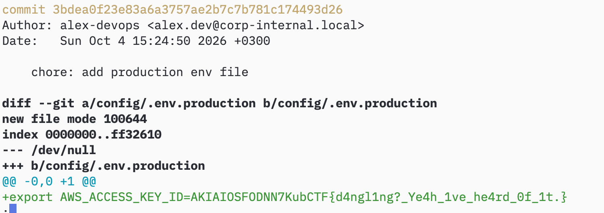

Основа таски - висячий (Dangling) коммит.
1. Распакуйте архив
2. Пропишите `git fsck --lost-found` в терминале. Вы получите сообщение `dangling commit 3bdea0f23e83a6a3757ae2b7c7b781c174493d26`.
3. Теперь надо посмотреть этот коммит. `git show 3bdea0f23e83a6a3757ae2b7c7b781c174493d26`

