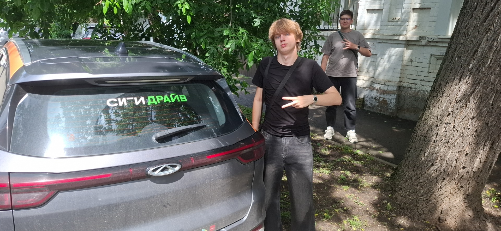
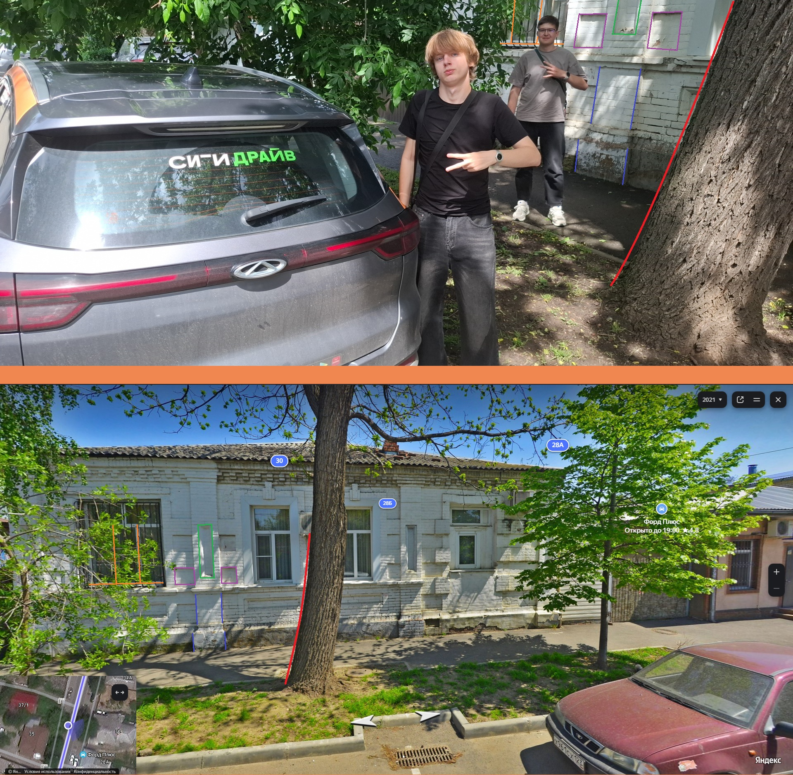

# Carsharing

> **Category:** OSINT · **Event:** KubSTU CTF 2026 Autumn

## 📌 Task



One day after classes my friends and I took a carsharing car and drove around the center. We dumped the car somewhere in the shade of trees and took a photo as a keepsake. While we were looking for the next one, we completely forgot where we left this one. Help us remember: where did we park it? Coordinates with 4 digits after the decimal point will be enough.

Flag format — `KubSTU{xx.xxxx_yy.yyyy}`

**Files:** [carsharing_hq.jpg](../../../assets/OSINT/Carsharing/carsharing_hq.jpg)

## 🏁 Solution

### Step 1. Metadata

First of all we check the EXIF: sometimes the phone saves GPS coordinates in the photo, and then the task is solved in a minute.

```
exiftool carsharing_hq.jpg

ExifTool Version Number         : 13.45
File Name                       : carsharing_hq.jpg
Directory                       : .
File Size                       : 767 kB
File Modification Date/Time     : 2026:10:06 12:29:44+03:00
File Access Date/Time           : 2026:10:06 16:58:06+03:00
File Creation Date/Time         : 2026:10:06 12:30:09+03:00
File Permissions                : -rw-rw-rw-
File Type                       : JPEG
File Type Extension             : jpg
MIME Type                       : image/jpeg
Exif Byte Order                 : Big-endian (Motorola, MM)
Y Resolution                    : 72
X Resolution                    : 72
Camera Model Name               : SM-A556E
Make                            : samsung
Software                        : A556EXXU7BYDB
Y Cb Cr Positioning             : Centered
Exif Version                    : 0220
Aperture Value                  : 1.8
Scene Type                      : Unknown (?)
Exposure Compensation           : 0
Exposure Program                : Program AE
Color Space                     : sRGB
Max Aperture Value              : 1.7
Brightness Value                : 6.09
Flashpix Version                : 0100
Date/Time Original              : 2026:05:26 14:23:25
Warning                         : [minor] Unrecognized MakerNotes
Sub Sec Time Original           : 0035
White Balance                   : Auto
Interoperability Index          : R98 - DCF basic file (sRGB)
Custom Rendered                 : Normal
Exposure Mode                   : Auto
Exposure Time                   : 1/681
Flash                           : No Flash
Sub Sec Time                    : 127
F Number                        : 1.8
User Comment                    :
Saturation                      : Normal
Components Configuration        : Err (63), Err (63), Err (63), -
ISO                             : 50
Focal Length In 35mm Format     : 23 mm
Sub Sec Time Digitized          : 0035
Contrast                        : Normal
Sharpness                       : Normal
Digital Zoom Ratio              : 0
Create Date                     : 2026:05:26 14:23:25
Shutter Speed Value             : 1/671
Metering Mode                   : Center-weighted average
Focal Length                    : 5.5 mm
Scene Capture Type              : Standard
Light Source                    : Unknown
Orientation                     : Horizontal (normal)
Resolution Unit                 : inches
Modify Date                     : 2026:05:26 14:23:25
JFIF Version                    : 1.01
Profile CMM Type                :
Profile Version                 : 4.3.0
Profile Class                   : Display Device Profile
Color Space Data                : RGB
Profile Connection Space        : XYZ
Profile Date Time               : 2016:01:01 00:00:00
Profile File Signature          : acsp
Primary Platform                : Unknown ()
CMM Flags                       : Not Embedded, Independent
Device Manufacturer             :
Device Model                    :
Device Attributes               : Reflective, Glossy, Positive, Color
Rendering Intent                : Media-Relative Colorimetric
Connection Space Illuminant     : 0.9642 1 0.82491
Profile Creator                 :
Profile ID                      : 0
Profile Description             : sRGB
Red Matrix Column               : 0.43607 0.22249 0.01392
Green Matrix Column             : 0.38515 0.71687 0.09708
Blue Matrix Column              : 0.14307 0.06061 0.7141
Media White Point               : 0.9642 1 0.82491
Red Tone Reproduction Curve     : (Binary data 40 bytes, use -b option to extract)
Green Tone Reproduction Curve   : (Binary data 40 bytes, use -b option to extract)
Blue Tone Reproduction Curve    : (Binary data 40 bytes, use -b option to extract)
Profile Copyright               : Google Inc. 2016
Image Width                     : 1920
Image Height                    : 886
Encoding Process                : Baseline DCT, Huffman coding
Bits Per Sample                 : 8
Color Components                : 3
Y Cb Cr Sub Sampling            : YCbCr4:2:0 (2 2)
Aperture                        : 1.8
Image Size                      : 1920x886
Megapixels                      : 1.7
Scale Factor To 35 mm Equivalent: 4.2
Shutter Speed                   : 1/681
Create Date                     : 2026:05:26 14:23:25.0035
Date/Time Original              : 2026:05:26 14:23:25.0035
Modify Date                     : 2026:05:26 14:23:25.127
Circle Of Confusion             : 0.007 mm
Field Of View                   : 76.1 deg
Focal Length                    : 5.5 mm (35 mm equivalent: 23.0 mm)
Hyperfocal Distance             : 2.36 m
Light Value                     : 12.1
```

There are no shooting coordinates in the metadata. All that's left is geolocation by the image itself.

### Step 2. What's visible in the photo

**City.** On the rear window of the car there is a "Citydrive" (Ситидрайв) carsharing sticker. Carsharing itself works in many cities, but the competition is from Krasnodar, and Citydrive is present in Krasnodar. It's logical to start the search there.

**Building.** On the right, a low house of red brick with decorative masonry: pilasters, a profiled cornice. The walls are whitewashed, the plaster is peeling in places, there are bars on the windows. This is the pre-revolutionary development of old Yekaterinodar. Such houses are almost never found in the residential districts (FMR, YuMR, KMR, Gidrostroy) and are concentrated in the historic center.

**Street profile.** The car stands on the roadway. Beyond it there is a wide strip of earth with old large trees, behind it a narrow asphalt sidewalk, and the house stands right behind the sidewalk, on the building line. This is how the streets of the old grid layout of the center are arranged: a narrow road, lawns with trees, low-rise houses right up against the sidewalk.

**Surroundings.** There are no high-rises in the background, only low buildings and trees around. This once again points to the old center, not to the new districts.

**Conclusion:** the photo was taken in the historic center of Krasnodar, in a block of old development between Severnaya and Postovaya streets. Next we look for the specific house on panoramas.

### Step 3. Examining the panorama

After some time we arrive at a panorama at coordinates **45.025635, 38.981874**. The house here looks extremely similar to the one we're after, however the 2025 panorama is not very informative. If you check the panoramas from other years, the 2021 one is the best of all.

We start comparing.



We get 5 matching elements, therefore we have found the correct coordinates.

Now we submit the flag — `KubSTU{45.0256, 38.9818}`

**Flag:** `KubSTU{45.0256, 38.9818}`
