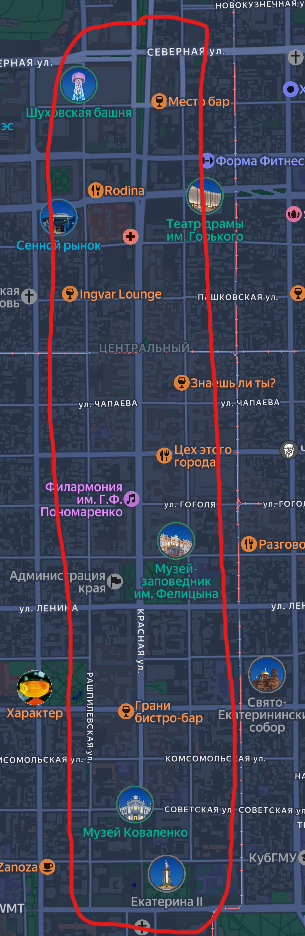
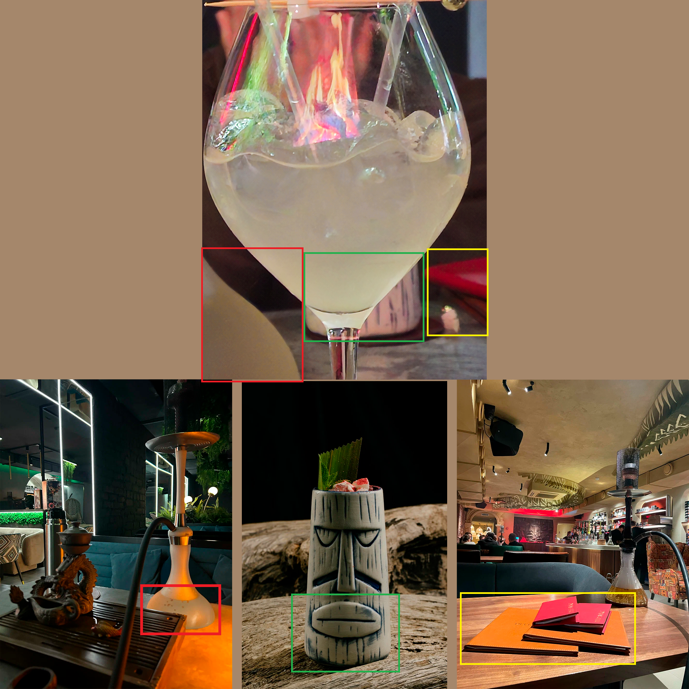
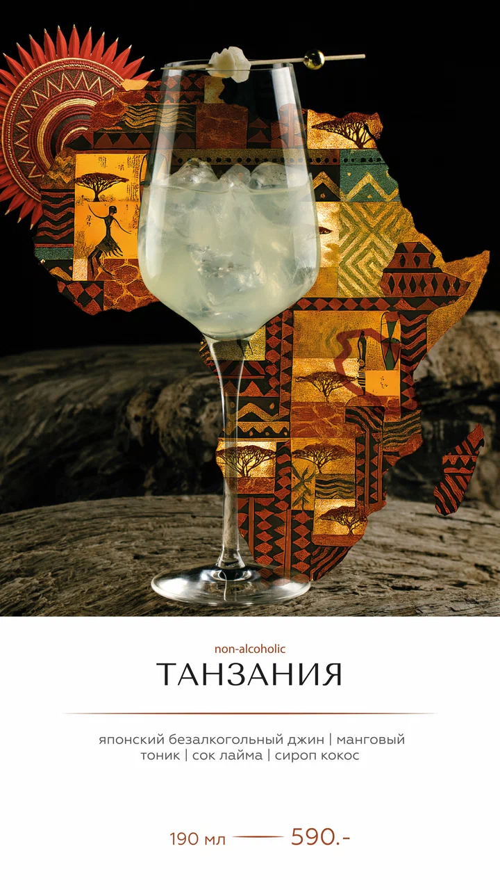

# Afterparty

> **श्रेणी:** OSINT · **इवेंट:** KubSTU CTF 2026 Autumn

## 📌 कार्य

वसंत वाले KubSTU CTF के समाप्त होने के बाद हम आराम करने निकले और एक जगह जा पहुँचे। यहाँ बहुत बढ़िया है — हमने Uno खेलते हुए शानदार समय बिताया और साथ ही साथ शरद वाले CTF के लिए सामग्री भी तैयार कर ली।

मुझे लगता है हम वहाँ एक से ज़्यादा बार लौटेंगे :)

वह जगह ढूँढ़ो जहाँ हमने समय बिताया और मेरे कॉकटेल का नाम बताओ।

फ़्लैग फ़ॉर्मैट: `KubSTU{VenueName_CocktailName}`

**फ़ाइलें:** [cocktail.jpg](../../../assets/OSINT/Afterparty/cocktail.jpg)

## 🏁 समाधान

### चरण 1. तस्वीर को सुरागों में तोड़ना

सबसे पहले हम वह सब कुछ लिख लेते हैं जिस पर पकड़ बनाई जा सके, सिर्फ़ गिलास ही नहीं:
- **ट्यूलिप गिलास और एक कस्टम हाईबॉल।** यह आकार सिग्नेचर कॉकटेल के लिए विशिष्ट है, किसी सामान्य बार/पब के लिए नहीं।
- **गिलास के प्रतिबिंब में एक लौ।** इसका मतलब पीछे आग जैसी कोई चीज़ है (फायरप्लेस या टीवी)।
- **पृष्ठभूमि में एक हुक़्क़ा बाउल।** एक विशिष्ट स्टैंड पर तरल वाला गोल बर्तन — सिल्हूट साफ़ पढ़ा जाता है। यह जगह लगभग निश्चित रूप से एक हुक़्क़ा लाउंज या हुक़्क़ा-बार है।
- **दाईं ओर एक लाल चमड़े की वस्तु।** यह चमड़े की जिल्द वाले मेन्यू जैसी दिखती है (बाद में पुष्टि होती है)।
- **रोशनी और पृष्ठभूमि।** गर्म, मद्धम रोशनी, लकड़ी का बार फ़र्नीचर — एक लाउंज फ़ॉर्मैट।

शहर को संदर्भ से जोड़ा जा सकता है: KubSTU + सूचना सुरक्षा = **Krasnodar**।

### चरण 2. भूगोल को सीमित करना

हम गूगल करते हैं "bar street in Krasnodar" / "restaurant street in Krasnodar"। लगातार केंद्र में **Krasnaya St** और उसके समानांतर **Rashpilevskaya** तथा **Krasnoarmeyskaya** सामने आती हैं।

इस क्षेत्र में 300+ अलग-अलग जगहें हैं — ब्रूट-फ़ोर्स के लिए बहुत ज़्यादा, इसलिए हम चरण 1 के सुरागों से फ़िल्टर करते हैं।

### चरण 3. सख़्त फ़िल्टरिंग

केंद्र की सभी जगहों में से हम केवल वही रखते हैं जो एक साथ:
1. **हुक़्क़ा लाउंज / हुक़्क़ा वाले बार** (सुराग — पृष्ठभूमि में बाउल)।
2. **सिग्नेचर कॉकटेल बनाते हैं।**
3. **प्रीमियम सेगमेंट** (गिलास और साज-सज्जा के आधार पर)।

इस फ़िल्टर के बाद ~10–15 उम्मीदवार बचते हैं। इस चरण पर दो रास्ते अपनाए जा सकते हैं:
- **रिवर्स इमेज सर्च**
- 2GIS / Yandex Maps पर **सीधी खोज**

### चरण 4. जगह की पुष्टि

हम उम्मीदवारों को रिव्यू फ़ोटो गैलरियों और आधिकारिक कंटेंट से जाँचते हैं। मूल तस्वीर के विवरणों से मेल खोजते हैं:

| मूल तस्वीर में सुराग | जगह की गैलरी में पुष्टि |
|---|---|
| हुक़्क़ा बाउल, स्टैंड | अन्य तस्वीरों में उसी प्रकार का हुक़्क़ा |
| लाल चमड़े की वस्तु | लाल चमड़े की जिल्द वाला मेन्यू |
| लकड़ी की काउंटरटॉप | उसी शैली का बार फ़र्नीचर |
| टिकी / सेरामिक बर्तन | जगह की अन्य तस्वीरों में दिखाई देते हैं |

सारे मेल एक ही जगह पर मिलते हैं: **DeepSmoke, Krasnoarmeyskaya St, 68.**

### चरण 5. कॉकटेल की पहचान

हम DeepSmoke का कॉकटेल मेन्यू खोलते हैं (Yandex Maps की तस्वीरों वाला मेन्यू)। हम मिलते-जुलते गिलास में एक नॉन-अल्कोहलिक कॉकटेल ढूँढ़ते हैं।

मेल: **«Tanzania»** (non-alcoholic) — जापानी नॉन-अल्कोहलिक जिन, मैंगो टॉनिक, नींबू का रस, नारियल सिरप।

गिलास का आकार और गार्निश-स्कूअर मूल तस्वीर से मेल खाते हैं — यही है वह।

**फ़्लैग:** `KubSTU{DeepSmoke_Tanzania}` · `KubSTU{DeepSmoke_Танзания}`
