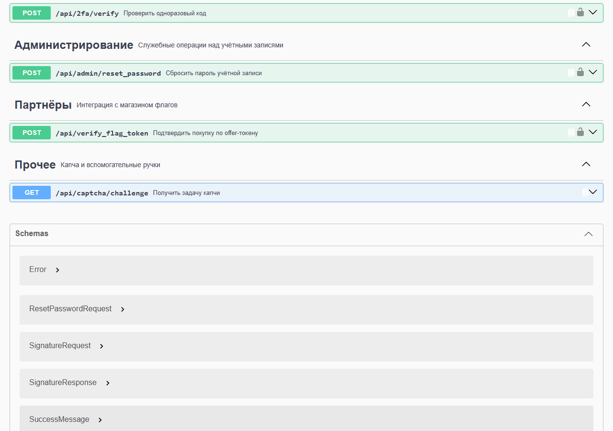
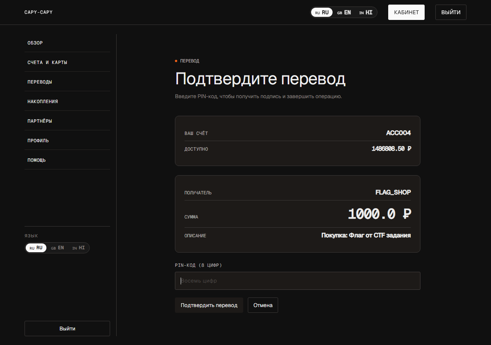
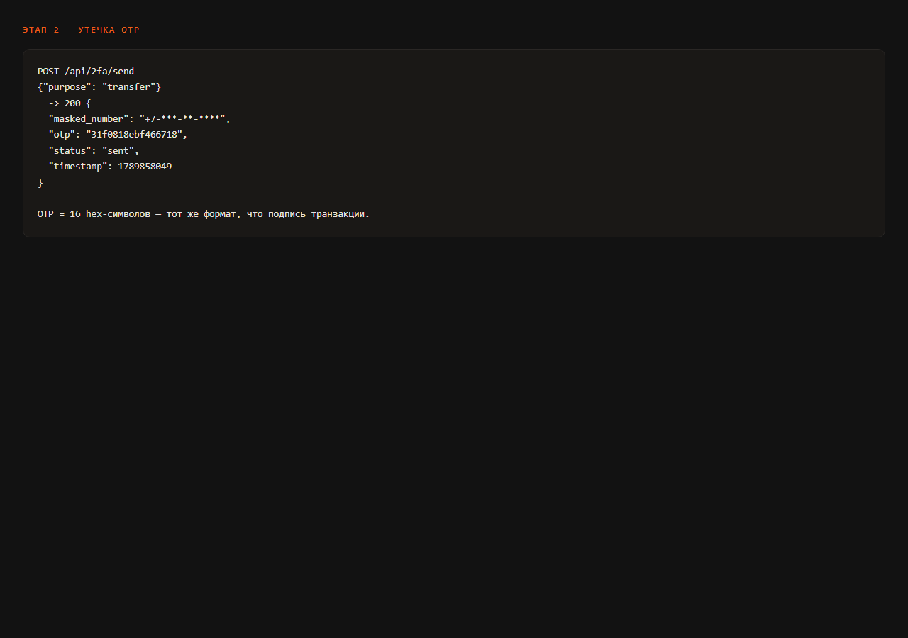
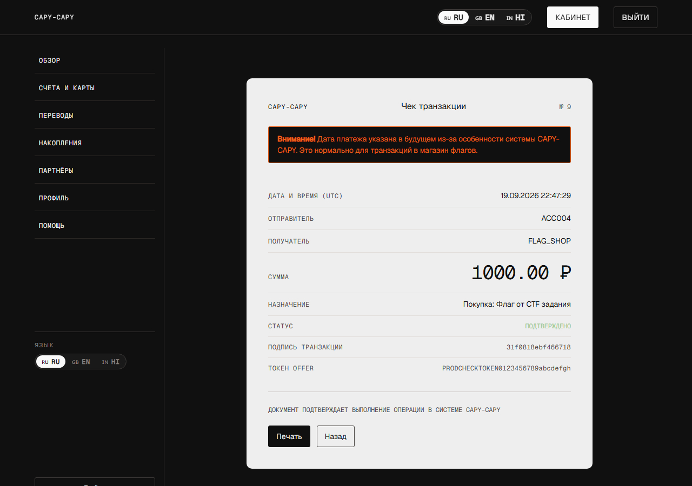

# Bank-1

> **श्रेणी:** Web · **इवेंट:** KubSTU CTF 2026 Autumn

## 📌 कार्य

CAPY-CAPY एक Flask पर बना इंटरनेट-बैंक है। फ़्लैग एक बंद "Flag Shop" में बेचा जाता है, जो केवल प्रीमियम ग्राहकों के लिए उपलब्ध है; भुगतान खाते से काटा जाता है और एक एकल-उपयोग offer-टोकन के ज़रिए Telegram-बॉट द्वारा पुष्ट किया जाता है।

एकमात्र प्रीमियम उपयोगकर्ता `mgalankov@4274` है, जिसका खाता `ACC004` और बैलेंस लगभग 1.49 मिलियन ₽ है। फ़्लैग की कीमत 1000 ₽ है, इसलिए पूरा कार्य एक ही बात पर सिमट जाता है: उसके नाम से एक भुगतान करना।


*शुरुआती बिंदु। लॉगिन और रजिस्ट्रेशन फ़ॉर्म के अलावा कुछ नहीं — यह दिखावटी पेज न तो कोई लॉगिन देता है और न ही खाता-संख्याएँ।*

हर ट्रांसफ़र को एक 16-वर्णों वाले HMAC-हस्ताक्षर से हस्ताक्षरित किया जाता है, जिसे सर्वर **केवल** PIN-कोड की जाँच के बाद ही जारी करता है। PIN आठ अंकों का है, वह सादे रूप में संग्रहीत नहीं होता, और ब्रूट-फ़ोर्स प्रति मिनट 20 प्रयासों तक सीमित है। यही वह दीवार है जिसे पार करने को कार्य कहता है।

## 🏁 समाधान

### संक्षिप्त सारांश

तीन स्वतंत्र खामियों की एक शृंखला। अकेले कोई भी फ़्लैग नहीं देती; मिलकर वे किसी दूसरे के खाते पर पूरा कब्ज़ा देती हैं।

| № | भेद्यता | सार |
|---|---|---|
| 1 | टूटा हुआ एक्सेस कंट्रोल (CWE-639) | पासवर्ड-रीसेट का आंतरिक एंडपॉइंट भूमिका (role) की जाँच नहीं करता और प्रतिक्रिया में पीड़ित का लॉगिन लौटा देता है |
| 2 | दूसरे कारक का रिसाव (CWE-200) | OTP अनुरोध कोड को सीधे HTTP-प्रतिक्रिया की बॉडी में लौटा देता है |
| 3 | गुप्त नामस्थानों का मिश्रण | 2FA कोड और भुगतान-हस्ताक्षर एक ही जनरेटर से बनते हैं, इसलिए OTP हस्ताक्षर के बदले स्वीकार हो जाता है |

### चरण 0. टोह (Reconnaissance)

हम एक सामान्य खाता रजिस्टर करते हैं — यह एक पैर जमाने की जगह के रूप में चाहिए: लगभग सभी दिलचस्प एंडपॉइंट्स को एक वैध JWT चाहिए।


*फ़ॉर्म को रूसी पूरा नाम, ड्राइविंग लाइसेंस और एक ALTCHA PoW कैप्चा चाहिए। लॉगिन सर्वर द्वारा बनाया जाता है: पहले नाम का पहला अक्षर + उपनाम का लिप्यंतरण + चार यादृच्छिक अंक।*

इसके बाद पूरी टोह की मुख्य खोज आती है। साइट के फ़ुटर में एक "API Documentation" लिंक है, और वह **बिना किसी प्राधिकरण वाले खुले Swagger** की ओर ले जाता है।


*`/api/docs` — पूरी स्पेसिफ़िकेशन गुमनाम रूप से परोसी जाती है। यहाँ वे एंडपॉइंट्स सूचीबद्ध हैं जिनका इंटरफ़ेस में कहीं कोई लिंक नहीं है।*



*"Administration" अनुभाग — एक ही एंडपॉइंट: `POST /api/admin/reset_password`, "किसी उपयोगकर्ता के लिए उसके पहचानकर्ता (identifier) द्वारा नया पासवर्ड सेट करता है"।*

> **यह खोज क्यों है।** इंटरफ़ेस में पासवर्ड बदलने की सुविधा है — "Profile" पेज पर। पर वह फ़ॉर्म मौजूदा पासवर्ड माँगता है और केवल अपना ही बदलता है। Swagger वाला एंडपॉइंट इनमें से कुछ नहीं माँगता और *किसी दूसरे का* पहचानकर्ता स्वीकार करता है।

### चरण 1. IDOR: किसी दूसरे का पासवर्ड और लॉगिन का रिसाव

एंडपॉइंट केवल `@jwt_required()` से सुरक्षित है — यानी यह केवल जाँचता है कि कॉल करने वाला लॉगिन किया हुआ है, और इससे अधिक कुछ नहीं:

```python
# app.py — /api/admin/reset_password
target = User.query.get(target_user_id)
# нет проверки роли и нет сверки target_user_id с текущим пользователем
target.password = generate_password_hash(new_password)
```

पहचानकर्ता छोटे पूर्णांक हैं, इसलिए हम उन्हें एक-एक करके गिनते (enumerate) हैं। और यहाँ दूसरी खामी है: **प्रतिक्रिया उस उपयोगकर्ता का लॉगिन लौटाती है** जिसका पासवर्ड हमने अभी बदला। पीड़ित का निक पहले से जानना ज़रूरी नहीं — एंडपॉइंट खुद ही उसे बता देता है।


```
uid=1 [200] Пароль пользователя aalice@1234 изменён
uid=2 [200] Пароль пользователя bbob@5678 изменён
uid=3 [200] Пароль пользователя ccharlie@9012 изменён
uid=4 [200] Пароль пользователя mgalankov@4274 изменён   ← премиум
uid=5 [200] Пароль пользователя ihakerov@1424 изменён    ← это мы сами
uid=6 [404] Целевой пользователь не найден
```

चारों में से कौन प्रीमियम है, यह पहले से पता नहीं, पर वे कुल चार ही हैं: हम बारी-बारी से लॉगिन करके देखते हैं कि किसका शॉप खुलता है।

### चरण 2. प्रीमियम खाते पर कब्ज़ा

हम `mgalankov@4274` के रूप में उसी पासवर्ड से लॉगिन करते हैं जो हमने खुद सेट किया था।


*खाता ACC004, बैलेंस 1 486 808.50 ₽ और भुगतान का इतिहास। खाता अब हमारा है।*


*"Flag Shop" खुल गया — `user.is_premium` जाँच पास हो गई।*

### चरण 3. दीवार: PIN-कोड

हम offer-टोकन डालते हैं, "Buy" दबाते हैं — और ठीक उसी चीज़ से टकराते हैं जिसके लिए यह कार्य बना है।



*लेन-देन का हस्ताक्षर पाने के लिए आठ-अंकीय PIN चाहिए। प्रति मिनट 20 अनुरोधों की सीमा पर 10⁸ विकल्पों को ब्रूट-फ़ोर्स करना — यह हज़ारों साल लेगा।*

अपेक्षित प्रवाह: पेज PIN को `/api/get_signature` पर भेजता है, सर्वर उसे सत्यापित करके एक ऐसा हस्ताक्षर जारी करता है जो प्राप्तकर्ता, राशि और विवरण से कसकर बँधा होता है। हस्ताक्षर एकल-उपयोग का है और पाँच मिनट जीवित रहता है। इसे जाली नहीं बनाया जा सकता — HMAC-कुंजी सर्वर पर है।

मतलब, हस्ताक्षर को जाली नहीं बनाना है, बल्कि *किसी दूसरे चैनल से वैध रूप से प्राप्त करना* है।

### चरण 4. वह दूसरा कारक जो खुद को ही उजागर कर देता है

Swagger में "Security" अनुभाग है जिसमें एंडपॉइंट `POST /api/2fa/send` है — "ट्रांसफ़र की पुष्टि के लिए OTP भेजता है"। हम इसे कॉल करके प्रतिक्रिया देखते हैं:



```json
POST /api/2fa/send  {"purpose": "transfer"}

{
  "masked_number": "+7-***-**-****",
  "otp": "31f0818ebf466718",
  "status": "sent",
  "timestamp": 1789858049
}
```

फ़ोन नंबर सावधानी से छिपाया गया है — पर एकल-उपयोग कोड खुद प्रतिक्रिया में सादे रूप में पड़ा है।

> **वह ब्योरा जो सब कुछ तय कर देता है।** OTP SMS वाले छह अंक नहीं है। यह *16 हेक्साडेसिमल वर्ण* हैं — ठीक वही प्रारूप जिसमें बैंक रसीद पर लेन-देन का हस्ताक्षर छापता है।

### चरण 5. हस्ताक्षर के बदले OTP

प्रारूप का मेल संयोग नहीं है। 2FA कोड उसी जनरेटर से बनता है जिससे भुगतान का हस्ताक्षर:

```python
# app.py — генерация 2FA-кода
ts  = int(datetime.now(timezone.utc).timestamp())
otp = generate_signature_from_timestamp(ts)   # тот же HMAC, что у подписи
```

और ट्रांसफ़र हैंडलर, जब PIN के लिए जारी की गई सूची में हस्ताक्षर नहीं पाता, तो उसे अप्रयुक्त OTP के बीच खोजने लगता है — और स्वीकार कर लेता है:

```python
# app.py — /transfer
ok, reason = consume_pending_signature(...)   # не прошло: PIN мы не вводили
if not ok:
    otp_rec = TwoFactorCode.query.filter_by(
        user_id=user.id, code=transaction_signature,
        purpose='transfer', used=False).first()
    if otp_rec:
        ok = True
        transaction_timestamp = otp_rec.signature_timestamp
```

हम ट्रांसफ़र फ़ॉर्म को हाथ से भेजते हैं, OTP को `transaction_signature` फ़ील्ड में रखकर। PIN बिल्कुल नहीं डालते:

```http
POST /transfer

to_account             = FLAG_SHOP
amount                 = 1000.00
product_id             = 1
token                  = <offer-токен из Telegram-бота>
transaction_timestamp  = 1789858049
transaction_signature  = 31f0818ebf466718   ← это OTP
```


*"Purchase confirmed! Флаг отправлен в Telegram бот." बैलेंस ठीक 1000 ₽ घट गया।*

रसीद में कोई संदेह नहीं छोड़ती कि हस्ताक्षर के रूप में ठीक वही एकल-उपयोग कोड काम आया:



*"Transaction signature" फ़ील्ड — `31f0818ebf466718`, वही OTP।*

### फ़्लैग

```
KubSTU{0tp_1s_th3_s1gnatur3_c4py_b4nk_0wn3d}
```

बॉट `FLAG_CONTENT` में केवल भीतरी हिस्सा रखता है और उसे खुद लपेटता है (`f'KubSTU{{{flag_content}}}'`)। पुष्ट खरीद के बाद वह स्ट्रिंग को संदेश के रूप में भेजता है और `flag.txt` फ़ाइल के रूप में उसकी नकल भी देता है।

### जड़: हस्ताक्षर में क्या गड़बड़ है

हस्ताक्षर कुल दो फ़ील्ड्स से गणना किया जाता है:

```python
# notquiterandom.py
message = timestamp.to_bytes(8, "big") + counter.to_bytes(8, "big")
mac = hmac.new(self._key, message, hashlib.sha256).digest()
```

इसमें न राशि है, न प्राप्तकर्ता, न प्रेषक। हस्ताक्षर को किसी विशिष्ट भुगतान से बाँधने वाली एकमात्र चीज़ सर्वर-साइड whitelist थी, जिसमें प्रविष्टि PIN-जाँच के बाद ही पहुँचती थी। OTP वाली शाखा इस whitelist को पूरी तरह बायपास कर देती है, और उसके साथ ही सारी बाइंडिंग टूट जाती है: एक जारी किया गया OTP **किसी भी खाते और किसी भी राशि** के ट्रांसफ़र को अधिकृत कर देता है।

यहाँ क्रिप्टोग्राफ़ी का कोई दोष नहीं — HMAC-SHA256 ईमानदार है और कुंजी लीक नहीं हुई। जो टूटा है वह विश्वास-मॉडल है: एक उद्देश्य (यह पुष्टि कि उपयोगकर्ता के पास फ़ोन है) के लिए जारी किया गया गुप्त कोड दूसरे उद्देश्य (यह पुष्टि कि उपयोगकर्ता ने किसी विशिष्ट भुगतान को मंज़ूरी दी) के लिए स्वीकार कर लिया जाता है।

### रास्ते में क्या-क्या रुकावट है

| तंत्र | क्या करता है | कैसे पार किया जाता है |
|---|---|---|
| ALTCHA PoW कैप्चा | लॉगिन, रजिस्ट्रेशन, पासवर्ड रीसेट और OTP अनुरोध पर ज़रूरी। चैलेंज एकल-उपयोग का है, 120 सेकंड जीवित रहता है | ब्राउज़र में हल होता है: ऐसा `n` खोजें कि `sha256(salt + n)` चैलेंज के बराबर हो |
| User-Agent द्वारा एंटी-बॉट | POST अनुरोधों पर `python-requests`, `curl`, `HeadlessChrome` आदि को काट देता है | असली ब्राउज़र से काम करें या सामान्य UA सेट करें |
| Rate-limit | पासवर्ड रीसेट — 10/मिनट, PIN जाँच — 20/मिनट, प्रति IP | पाँच ID गिनना सीमा में आ जाता है; PIN ब्रूट-फ़ोर्स के लिए यह कभी काफ़ी नहीं होगा |

> **एक गतिरोध जिसका ज़िक्र करना उचित है।** "Security" पेज पर एक दो-कारक (2FA) टॉगल है। यह `is_2fa` फ़ील्ड लिखता है, जिसे ट्रांसफ़र लॉजिक में एक बार भी नहीं पढ़ा जाता — उसे टॉगल करने से कुछ नहीं बदलता। एक झूठा निशान।

### कैसे ठीक करें

1. **भूमिका (role) की जाँच जोड़ें** `/api/admin/reset_password` में और प्रतिक्रिया में लॉगिन न लौटाएँ — एक तटस्थ "done" ही काफ़ी है।
2. **OTP को HTTP-प्रतिक्रिया में कभी न दें।** दूसरा कारक किसी अलग चैनल से जाना चाहिए, वरना वह दूसरा कारक है ही नहीं।
3. **गुप्त नामस्थानों को अलग करें।** OTP और भुगतान-हस्ताक्षर को अलग कुंजियों और अलग संदर्भ के साथ गणना किया जाना चाहिए — तब एक को दूसरे के बदले रखना सैद्धांतिक रूप से ही काम करना बंद कर देता है।
4. **भुगतान को ही हस्ताक्षरित करें।** हस्ताक्षर में प्रेषक, प्राप्तकर्ता, राशि और विवरण शामिल करें, केवल timestamp नहीं।
5. **बायपास शाखा हटाएँ** `/transfer` में: हस्ताक्षर केवल उसी whitelist से स्वीकार हो जो PIN के बाद जारी हुई हो।
6. **लॉगिन की प्रतिक्रियाओं में अंतर मिटाएँ।** अभी "user not found" और "wrong password" अलग-अलग संदेश हैं, जो अपने आप में लॉगिन की गिनती की अनुमति दे देता है।

*यह वॉकथ्रू स्टैंड `127.0.0.1:35801` पर किया गया, जो प्रोडक्शन कॉन्फ़िगरेशन के साथ चैलेंज के सोर्स से डिप्लॉय किया गया था। स्क्रीनशॉट एक ही निरंतर रन के दौरान लिए गए; फ़्लैग उसी खरीद के परिणामस्वरूप Telegram-बॉट द्वारा जारी किया गया।*

**फ्लैग:** `KubSTU{0tp_1s_th3_s1gnatur3_c4py_b4nk_0wn3d}`
